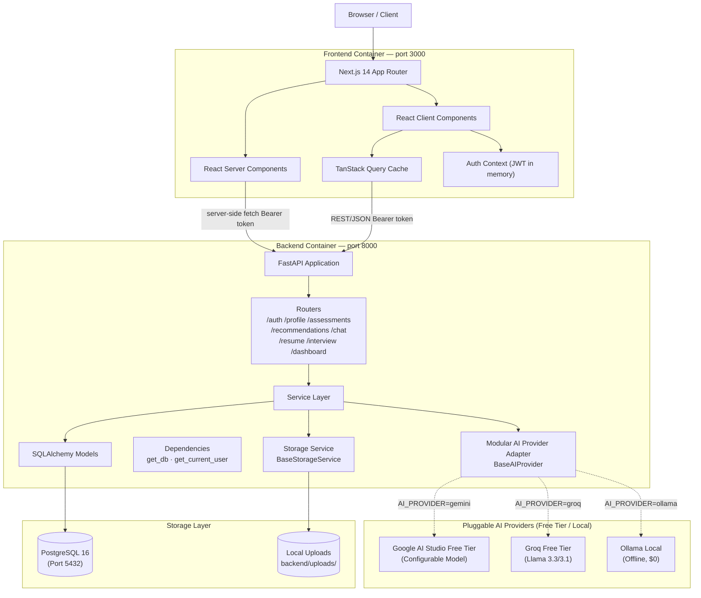
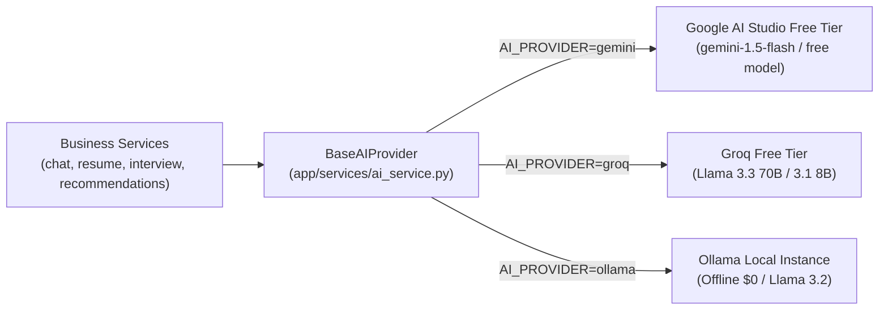
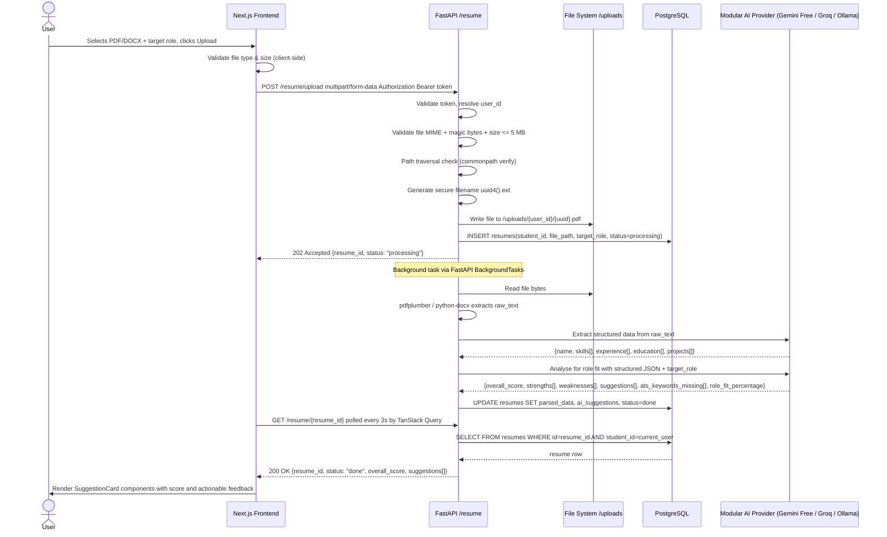

# Architecture — AI-Powered Placement Coach

## Table of Contents
1. [System Architecture Overview](#1-system-architecture-overview)
2. [Frontend Architecture](#2-frontend-architecture)
3. [Backend Architecture](#3-backend-architecture)
4. [Authentication Flow](#4-authentication-flow)
5. [AI Integration Architecture](#5-ai-integration-architecture)
6. [File Handling](#6-file-handling)
7. [Docker Compose Services](#7-docker-compose-services)
8. [Environment Variable Strategy](#8-environment-variable-strategy)
9. [Resume Scan — Sequence Diagram](#9-resume-scan--sequence-diagram)

---

## 1. System Architecture Overview

The system is composed of three runtime containers orchestrated by Docker Compose, with two external service dependencies (PostgreSQL is containerised; Gemini API is a remote SaaS).

```
Browser
  │
  │  HTTPS (port 3000 in dev)
  ▼
┌─────────────────────────────────┐
│  Next.js 14 (App Router)        │  — React Server Components + Client Components
│  Tailwind CSS / shadcn/ui       │  — TanStack Query for data fetching
└────────────────┬────────────────┘
                 │ HTTP/REST (port 8000)
                 ▼
┌─────────────────────────────────┐
│  FastAPI (Python 3.11+)         │  — Async SQLAlchemy ORM
│  Uvicorn / Gunicorn workers     │  — JWT auth middleware
└──────┬─────────────┬────────────┘
       │             │
       │ asyncpg     │ HTTPS / HTTP (Free-Tier AI / Local AI)
       ▼             ▼
┌───────────┐  ┌───────────────────────────────────────────────┐
│ PostgreSQL│  │ Modular AI Provider Adapter                   │
│   16      │  │ • Primary: Google AI Studio Free Tier (Gemini)│
│(port 5432)│  │ • Alt Cloud: Groq Free Tier (Llama 3.3/3.1)   │
│           │  │ • Alt Local: Ollama (Offline / Llama 3.2)     │
└───────────┘  └───────────────────────────────────────────────┘
```

### High-Level Architecture Flowchart



---

## 2. Frontend Architecture

### Tech Stack
| Concern | Choice |
|---|---|
| Framework | Next.js 14+ (App Router, React 18) |
| Styling | Tailwind CSS v3 + shadcn/ui |
| Server state | TanStack Query v5 (`@tanstack/react-query`) |
| Client/auth state | React Context (`AuthProvider`) |
| HTTP | native `fetch` wrapped in a typed API client |
| Forms | React Hook Form + Zod |

### App Router Folder Structure

```
src/
├── app/
│   ├── layout.tsx                  # Root layout — QueryClientProvider, AuthProvider, Toaster
│   ├── page.tsx                    # Landing / marketing page
│   ├── (auth)/
│   │   ├── login/page.tsx
│   │   └── register/page.tsx
│   ├── (dashboard)/
│   │   ├── layout.tsx              # Protected layout — redirects if no access token
│   │   ├── dashboard/page.tsx      # Progress overview
│   │   ├── profile/page.tsx        # Student profile & placement goals
│   │   ├── assessments/
│   │   │   ├── page.tsx            # Assessment list
│   │   │   └── [id]/page.tsx       # Active assessment
│   │   ├── recommendations/page.tsx
│   │   ├── chat/page.tsx           # AI placement chatbot
│   │   ├── resume/
│   │   │   ├── page.tsx            # Upload & history
│   │   │   └── [scanId]/page.tsx   # Scan results & suggestions
│   │   └── interviews/
│   │       ├── page.tsx            # Session list
│   │       └── [sessionId]/page.tsx
├── components/
│   ├── ui/                         # shadcn/ui generated components
│   ├── layout/                     # Navbar, Sidebar, PageHeader
│   ├── auth/                       # LoginForm, RegisterForm
│   ├── chat/                       # ChatWindow, MessageBubble, TypingIndicator
│   ├── resume/                     # DropzoneUploader, SuggestionCard
│   ├── assessments/                # QuestionCard, Timer, ScoreSummary
│   └── dashboard/                  # ProgressChart, StreakBadge, GoalCard
├── lib/
│   ├── api/
│   │   ├── client.ts               # Typed fetch wrapper with auto token refresh
│   │   ├── auth.ts                 # /auth/* endpoint helpers
│   │   ├── resume.ts               # /resume/* endpoint helpers
│   │   └── …                       # one file per router domain
│   ├── hooks/
│   │   ├── useAuth.ts              # Reads AuthContext
│   │   └── useResumeScan.ts        # TanStack Query mutation + query
│   └── utils.ts
├── context/
│   └── AuthContext.tsx             # Stores accessToken in memory; refresh token in HttpOnly cookie
├── types/
│   └── api.ts                      # Mirrors backend Pydantic schemas
└── middleware.ts                   # Edge middleware — redirects unauthenticated routes
```

### State Management Approach

| State type | Storage | Tool |
|---|---|---|
| Access token (JWT) | JavaScript memory (module-level variable in `AuthContext`) | React Context |
| Refresh token | HttpOnly, Secure, SameSite=Strict cookie | Browser / Set-Cookie |
| Server data (profiles, assessments, scans…) | TanStack Query cache | `useQuery` / `useMutation` |
| Form state | Component-local | React Hook Form |
| Transient UI state | Component-local | `useState` |

> [!IMPORTANT]
> The access token is **never** written to `localStorage` or `sessionStorage`. It lives only in the React module scope inside `AuthContext`. On hard refresh the app calls `POST /auth/refresh` automatically using the HttpOnly cookie before rendering protected pages.

### Page-to-Feature Mapping

| Route | Feature | Key Query Keys |
|---|---|---|
| `/dashboard` | Progress tracking dashboard | `['progress', userId]` |
| `/profile` | Student profiles and placement goals | `['profile', userId]` |
| `/assessments` | Aptitude & technical assessments | `['assessments']` |
| `/recommendations` | Personalized recommendations | `['recommendations', userId]` |
| `/chat` | AI placement chatbot | `['chat', sessionId]` |
| `/resume` | Resume scanner | `['scans', userId]` |
| `/resume/[scanId]` | Role-specific suggestions | `['scan', scanId]` |
| `/interviews/[sessionId]` | Technical & HR interview practice | `['interview', sessionId]` |

---

## 3. Backend Architecture

### Tech Stack
| Concern | Choice |
|---|---|
| Framework | FastAPI 0.111+ |
| Server | Uvicorn (dev) / Gunicorn + UvicornWorker (prod) |
| ORM | SQLAlchemy 2.x async (`AsyncSession`) |
| Driver | asyncpg |
| Migrations | Alembic |
| Validation | Pydantic v2 |
| Auth | python-jose (JWT) + passlib[bcrypt] |
| Resume parsing | pdfplumber (PDF) · python-docx (DOCX) |
| AI SDK | google-generativeai |

### Project Structure

```
backend/
├── main.py                  # FastAPI app factory, router registration, CORS, lifespan
├── config.py                # Pydantic BaseSettings — reads from .env
├── database.py              # Async engine, AsyncSessionLocal, Base, get_db dependency
├── dependencies.py          # get_current_user, require_roles
├── alembic/
│   ├── env.py
│   └── versions/
├── routers/
│   ├── auth.py              # POST /auth/register, /auth/login, /auth/refresh, /auth/logout
│   ├── users.py             # GET/PUT /users/me, GET /users/me/profile
│   ├── assessments.py       # CRUD + submission + auto-grading
│   ├── recommendations.py   # GET /recommendations (Gemini-backed)
│   ├── chat.py              # POST /chat/message (streaming SSE)
│   ├── resume.py            # POST /resume/upload, GET /resume/scans, GET /resume/scans/{id}
│   ├── interviews.py        # POST /interviews/start, POST /interviews/{id}/respond
│   └── progress.py          # GET /progress/summary
├── services/
│   ├── auth_service.py      # Token creation, hashing, refresh token DB ops
│   ├── user_service.py
│   ├── assessment_service.py
│   ├── recommendation_service.py   # Calls Gemini flash
│   ├── chat_service.py             # Calls Gemini flash, manages conversation history
│   ├── resume_service.py           # Parse → extract → Gemini pro → persist
│   ├── interview_service.py        # Calls Gemini pro for question gen + feedback
│   └── progress_service.py
├── models/                  # SQLAlchemy ORM models (one file per domain)
│   ├── user.py
│   ├── profile.py
│   ├── assessment.py
│   ├── recommendation.py
│   ├── chat.py
│   ├── resume.py
│   ├── interview.py
│   ├── progress.py
│   └── refresh_token.py
├── schemas/                 # Pydantic v2 request/response schemas
│   ├── auth.py
│   ├── user.py
│   ├── assessment.py
│   ├── recommendation.py
│   ├── chat.py
│   ├── resume.py
│   ├── interview.py
│   └── progress.py
└── utils/
    ├── file_utils.py        # save_upload_file, allowed_extensions, get_secure_path
    └── gemini_client.py     # Singleton GenerativeModel instances
```

### Async SQLAlchemy Setup

```python
# backend/database.py
from sqlalchemy.ext.asyncio import create_async_engine, AsyncSession, async_sessionmaker
from sqlalchemy.orm import DeclarativeBase
from config import settings

engine = create_async_engine(
    settings.DATABASE_URL,          # postgresql+asyncpg://...
    pool_size=10,
    max_overflow=20,
    echo=settings.DB_ECHO,
)

AsyncSessionLocal = async_sessionmaker(
    engine, class_=AsyncSession, expire_on_commit=False
)

class Base(DeclarativeBase):
    pass

async def get_db() -> AsyncSession:
    async with AsyncSessionLocal() as session:
        yield session
```

### Request Lifecycle

```
HTTP Request
  → CORS Middleware
  → JWT Auth Middleware (validates Bearer token on protected routes)
  → Router (path + method match)
  → Dependency injection: get_db() → AsyncSession, get_current_user() → User ORM object
  → Route handler (thin — delegates to service)
  → Service (business logic + Gemini calls)
  → SQLAlchemy model → asyncpg → PostgreSQL
  → Pydantic schema serialisation
HTTP Response
```

---

## 4. Authentication Flow

### Token Lifecycle & Architecture
| Token | Type | Lifetime | Storage Location | Transmission | Security Attributes |
|---|---|---|---|---|---|
| **Access Token** | JWT (HS256) | 15 minutes | Client memory (React AuthContext / TanStack cache) | `Authorization: Bearer <token>` | Signed with `SECRET_KEY`; payload contains `sub` (user UUID) and `role` |
| **Refresh Token** | Opaque (64-byte urlsafe string) | 7 days | Client: `HttpOnly` Cookie; Server: `refresh_tokens` DB table | Auto-sent only to `/api/v1/auth/refresh` | Hashed with SHA-256 before DB insertion; single-use (rotated on every refresh) |

### Cookie Settings
The refresh token is set exclusively via `Set-Cookie` with the following attributes:
- `HttpOnly: true` — Cannot be read by JavaScript; immune to client-side XSS theft.
- `Secure: true` in production (`SECURE_COOKIES=False` in local HTTP development).
- `SameSite: Strict` — Mitigates Cross-Site Request Forgery (CSRF).
- `Path: /api/v1/auth/refresh` — Cookie is scoped strictly to the refresh endpoint; never sent with general API requests.
- `Max-Age: 604800` (7 days in seconds).

### `refresh_tokens` Table Schema
```sql
CREATE TABLE refresh_tokens (
    id          UUID PRIMARY KEY DEFAULT gen_random_uuid(),
    user_id     UUID NOT NULL REFERENCES users(id) ON DELETE CASCADE,
    token_hash  TEXT NOT NULL UNIQUE,   -- SHA-256 hex digest of raw refresh token
    expires_at  TIMESTAMPTZ NOT NULL,
    created_at  TIMESTAMPTZ NOT NULL DEFAULT now(),
    revoked     BOOLEAN NOT NULL DEFAULT FALSE
);
CREATE INDEX idx_rt_user_id ON refresh_tokens(user_id);
CREATE INDEX idx_rt_hash_active ON refresh_tokens(token_hash) WHERE revoked = FALSE;
```

### Password Hashing
- Algorithm: `bcrypt` with work factor 12.
- Salt is generated cryptographically per password.

### Step-by-Step Auth Lifecycles

1. **Registration (`POST /auth/register`)**:
   - Accepts `{email, password, full_name}`.
   - Validates password complexity (min 8 chars, 1 uppercase, 1 digit).
   - Verifies email uniqueness in `users` table.
   - Hashes password with bcrypt (cost 12), saves user record, returns `201 Created`.

2. **Login (`POST /auth/login`)**:
   - Accepts `{email, password}`.
   - Authenticates credentials against bcrypt hash.
   - Generates 15-minute access JWT: payload `{sub: user_id, role: user.role, exp, iat}`.
   - Generates 64-byte cryptographic random string (`secrets.token_urlsafe(64)`).
   - Computes SHA-256 hash of refresh token and saves to `refresh_tokens`.
   - Attaches `Set-Cookie: refresh_token=<raw>; HttpOnly; SameSite=Strict; Path=/api/v1/auth/refresh; Max-Age=604800`.
   - Returns `{access_token, token_type: "bearer", expires_in: 900, user: {...}}`.

3. **Access Token Verification**:
   - Reusable dependency `get_current_user` in `app/core/dependencies.py` extracts Bearer token, validates signature and expiration, and fetches the `User` ORM record from `db`.

4. **Token Refresh with Rotation (`POST /auth/refresh`)**:
   - Reads `refresh_token` from incoming cookie.
   - Computes SHA-256 hash and queries `refresh_tokens`.
   - **Breach Detection**: If token exists but `revoked = TRUE`, an alert is logged and all active tokens for that user are revoked immediately (token family revocation).
   - If token is not found or `expires_at < now()`, returns `401 Unauthorized` with error code `TOKEN_EXPIRED`.
   - If valid: marks old token as `revoked = TRUE`.
   - Issues a **brand new** refresh token (hashed and stored) and a **brand new** access token.
   - Sets updated `Set-Cookie` header and returns `{access_token, token_type: "bearer", expires_in: 900}`.

5. **Logout (`POST /auth/logout`)**:
   - Requires valid `Authorization: Bearer <access_token>`.
   - Reads refresh token cookie; sets `revoked = TRUE` in database.
   - Clears cookie via `Set-Cookie: refresh_token=; Max-Age=0; Path=/api/v1/auth/refresh`.

---

## 5. Modular AI Provider Architecture (Zero-Cost / Free-Tier)

### Strict Constraint: Free-Tier Only
The application is architected to operate with **$0 API costs**. No paid tiers, credit-card activations, or proprietary dependencies are assumed.

### Provider-Agnostic Interface (`BaseAIProvider`)
All AI operations are decoupled behind an abstract base class in `app/services/ai_service.py`. Business services (Chat, Resume, Interview, Recommendations) call this interface and are completely agnostic of the underlying provider.



### Configurable Model Architecture
Specific model identifiers are **never hardcoded**. They are configured via environment variables:
- `AI_PROVIDER`: `"gemini"` (default), `"groq"`, or `"ollama"`
- `AI_MODEL_CHAT`: e.g. `gemini-1.5-flash` (or `llama-3.1-8b-instant` for Groq, `llama3.2` for Ollama)
- `AI_MODEL_ANALYSIS`: e.g. `gemini-1.5-flash` (or `llama-3.3-70b-versatile` for Groq)

### Free-Tier Limitations & Rate Limit Mitigation

| Provider | Model | Free-Tier Limits | Quota Handling |
|---|---|---|---|
| **Google AI Studio (Gemini)** | `gemini-1.5-flash` (or free equivalent) | **15 RPM**, 1,000,000 TPM, **1,500 RPD**. No credit card required. | Catch HTTP 429 (`RESOURCE_EXHAUSTED`). Automatic exponential backoff retry (2s, 4s, 8s). Returns friendly error banner if daily quota hit. |
| **Groq Cloud (Free Tier)** | `llama-3.3-70b-versatile` / `llama-3.1-8b-instant` | **30 RPM**, 14,400 RPD. No credit card required. Fast token streaming. | Drop-in OpenAI-compatible SDK replacement via `groq` Python client. |
| **Local Ollama (Offline)** | `llama3.2` / `mistral` | **Unlimited RPM / RPD**, 100% offline, $0 cost. | Runs on `http://localhost:11434`. Perfect for offline development or when internet limits are exhausted. |

### Error Handling & Graceful Degradation
1. **Rate Limit (HTTP 429)**: The AI service catches rate-limit exceptions and retries up to 3 times with exponential backoff and jitter. If retries fail, it raises `AIServiceRateLimitError`, which the router translates to HTTP 429 with `Retry-After: 60`.
2. **Provider Downtime (HTTP 502/503)**: Catch network/API errors, log sanitized trace, return structured error JSON `{error: {code: "AI_UNAVAILABLE", message: "AI coach is temporarily resting. Please try again in a few moments."}}`.

---

## 6. File Handling & Secure Resume Storage

### Upload Security Specifications
Uploaded resumes represent sensitive student data and potential security attack vectors. The upload pipeline enforces multiple defense-in-depth layers:

1. **Randomized Filenames (UUIDv4)**:
   - Uploaded files are immediately renamed to `{uuid4()}.{ext}` upon receipt.
   - The original student filename is recorded in the database column `resumes.original_filename` for display purposes only.
   - The filesystem never contains user-supplied filenames.

2. **File Size Enforcement**:
   - Strict limit: **5 MB** (`MAX_UPLOAD_SIZE_BYTES = 5 * 1024 * 1024`).
   - Files exceeding 5 MB are rejected immediately before disk writing with `HTTP 413 Payload Too Large`.

3. **MIME Type & Magic Byte Validation**:
   - `Content-Type` header check: must be `application/pdf` or `application/vnd.openxmlformats-officedocument.wordprocessingml.document`.
   - **Magic byte signature check**:
     - PDF files must start with `b"%PDF-"` (`0x25 0x50 0x44 0x46`).
     - DOCX files must start with zip archive signature `b"PK\x03\x04"` (`0x50 0x4b 0x03 0x04`).
     - Files with mismatched extensions/signatures are rejected with `HTTP 415 Unsupported Media Type`.

4. **Path Traversal Prevention**:
   - Storage path is constructed strictly via `os.path.join(UPLOAD_DIR, str(user_id), f"{file_uuid}.{ext}")`.
   - The resolved canonical path is validated using `os.path.commonpath([target_path, UPLOAD_DIR]) == UPLOAD_DIR`. Any filename containing `..`, leading slashes, or null bytes (`\0`) is rejected.

5. **Authenticated Serving (No Static Exposure)**:
   - Upload directories are **never** mounted as public static files.
   - Resume files are retrieved exclusively via `GET /api/v1/resume/{resume_id}/file`.
   - The endpoint enforces `Depends(get_current_user)` and validates `resume.student_id == current_user.id` (or admin role), streaming the file via FastAPI `FileResponse`.

### Local Development Layout
```
backend/uploads/
└── {student_uuid}/
    └── {file_uuid}.pdf    # Mode 0600 (read/write by application only)
```

### Free Cloud-Storage Migration Path (Zero Egress Costs)
To move from local filesystem storage to production cloud storage without incurring costs:
1. **Cloudflare R2 (Recommended)**:
   - **Free Tier**: 10 GB of storage/month, 1,000,000 Class A operations, 10,000,000 Class B operations.
   - **Key Advantage**: **Zero egress bandwidth fees** (unlike AWS S3 or Google Cloud Storage which charge for downloads).
   - **Implementation**: R2 provides an S3-compatible API. Replace `LocalStorageService` with `S3StorageService` (using `aioboto3`) targeting the R2 endpoint URL and credentials in `.env`.
2. **Supabase Storage**:
   - **Free Tier**: 1 GB of file storage with standard S3/REST API access.

---

## 7. Docker Compose Services

```yaml
# docker-compose.yml
version: "3.9"

services:
  db:
    image: postgres:16-alpine
    container_name: placement_db
    restart: unless-stopped
    environment:
      POSTGRES_USER: ${POSTGRES_USER}
      POSTGRES_PASSWORD: ${POSTGRES_PASSWORD}
      POSTGRES_DB: ${POSTGRES_DB}
    volumes:
      - postgres_data:/var/lib/postgresql/data
    ports:
      - "5432:5432"
    healthcheck:
      test: ["CMD-SHELL", "pg_isready -U ${POSTGRES_USER} -d ${POSTGRES_DB}"]
      interval: 10s
      timeout: 5s
      retries: 5

  backend:
    build:
      context: ./backend
      dockerfile: Dockerfile
    container_name: placement_backend
    restart: unless-stopped
    depends_on:
      db:
        condition: service_healthy
    environment:
      DATABASE_URL: postgresql+asyncpg://${POSTGRES_USER}:${POSTGRES_PASSWORD}@db:5432/${POSTGRES_DB}
      SECRET_KEY: ${SECRET_KEY}
      GEMINI_API_KEY: ${GEMINI_API_KEY}
      UPLOAD_DIR: /uploads
      ENVIRONMENT: ${ENVIRONMENT:-development}
    volumes:
      - ./uploads:/uploads
      - ./backend:/app            # hot-reload in dev; remove in prod
    ports:
      - "8000:8000"
    command: uvicorn main:app --host 0.0.0.0 --port 8000 --reload

  frontend:
    build:
      context: ./frontend
      dockerfile: Dockerfile
    container_name: placement_frontend
    restart: unless-stopped
    depends_on:
      - backend
    environment:
      NEXT_PUBLIC_API_URL: ${NEXT_PUBLIC_API_URL:-http://localhost:8000}
    ports:
      - "3000:3000"
    volumes:
      - ./frontend:/app           # hot-reload in dev; remove in prod
      - /app/node_modules
      - /app/.next

volumes:
  postgres_data:
```

### Service Summary

| Service | Image / Build | Internal Port | External Port | Key Responsibility |
|---|---|---|---|---|
| `db` | `postgres:16-alpine` | 5432 | 5432 | Persistent data store |
| `backend` | `./backend/Dockerfile` | 8000 | 8000 | FastAPI API server + Alembic migrations on startup |
| `frontend` | `./frontend/Dockerfile` | 3000 | 3000 | Next.js SSR/SSG serving |

### Backend `Dockerfile` (reference)
```dockerfile
FROM python:3.12-slim
WORKDIR /app
COPY requirements.txt .
RUN pip install --no-cache-dir -r requirements.txt
COPY . .
# Migrations run before server start in entrypoint.sh
ENTRYPOINT ["sh", "entrypoint.sh"]
```

```bash
# backend/entrypoint.sh
#!/bin/sh
set -e
alembic upgrade head
exec uvicorn main:app --host 0.0.0.0 --port 8000 ${UVICORN_EXTRA_ARGS}
```

---

## 8. Environment Variable Strategy

### File Layout
```
AiPlacement/
├── .env                    # Shared defaults (committed with safe defaults only)
├── .env.local              # Local developer overrides — gitignored
├── backend/
│   └── .env                # Backend-only secrets — gitignored
└── frontend/
    └── .env.local          # Frontend-only config — gitignored
```

### Root `.env` (Docker Compose reads this)
```env
# PostgreSQL
POSTGRES_USER=placement_user
POSTGRES_PASSWORD=CHANGE_ME
POSTGRES_DB=placement_db

# FastAPI
SECRET_KEY=CHANGE_ME_32_BYTES_HEX
GEMINI_API_KEY=CHANGE_ME
ENVIRONMENT=development

# Next.js (public — safe to expose to browser)
NEXT_PUBLIC_API_URL=http://localhost:8000
```

### Backend `config.py` (Pydantic BaseSettings)
```python
from pydantic_settings import BaseSettings

class Settings(BaseSettings):
    DATABASE_URL: str
    SECRET_KEY: str
    GEMINI_API_KEY: str
    UPLOAD_DIR: str = "/uploads"
    ACCESS_TOKEN_EXPIRE_MINUTES: int = 15
    REFRESH_TOKEN_EXPIRE_DAYS: int = 7
    ENVIRONMENT: str = "development"
    DB_ECHO: bool = False

    class Config:
        env_file = ".env"

settings = Settings()
```

### Variable Ownership

| Variable | Who reads it | Committed? |
|---|---|---|
| `POSTGRES_PASSWORD` | Docker Compose → `db`, `backend` | No — override in `.env.local` |
| `SECRET_KEY` | `backend` only | No |
| `GEMINI_API_KEY` | `backend` only | No |
| `NEXT_PUBLIC_API_URL` | `frontend` build | Yes (safe default) |
| `DATABASE_URL` | `backend` (composed by Compose) | No |

> [!CAUTION]
> Never prefix secrets with `NEXT_PUBLIC_`. Variables with that prefix are inlined into the client-side JavaScript bundle at build time and are fully public.

---

## 9. Resume Scan — Sequence Diagram

This diagram illustrates the complete lifecycle of a resume upload and analysis request, covering the full stack from browser to Gemini and back.



---

## 10. Cost & Infrastructure Architecture ($0 Monthly Budget)

| Component | Technology | Tier / Plan | Monthly Cost | Constraints / Quotas |
|---|---|---|---|---|
| **Frontend Runtime** | Next.js 14 | Local Docker / Vercel Hobby | **$0.00** | Generous bandwidth on Vercel Hobby; 0 limits in local Docker |
| **Backend Runtime** | FastAPI + Python | Local Docker / Render Free / Fly.io | **$0.00** | 0 cost locally; ephemeral spin-down on Render free if used |
| **Primary Database** | PostgreSQL 16 | Local Docker / Supabase Free | **$0.00** | PostgreSQL in Docker has zero recurring cost or storage caps |
| **AI / LLM API** | Google AI Studio Free Tier | Gemini Free API Key (No card) | **$0.00** | 15 RPM, 1,500 RPD (plenty for development & demo) |
| **Fallback AI API** | Groq Cloud Free Tier | OpenAI-compatible (No card) | **$0.00** | 30 RPM, 14,400 RPD |
| **Local Offline AI** | Ollama (`llama3.2`) | Local host hardware | **$0.00** | Unlimited requests; completely offline |
| **File Storage** | Local filesystem (`/uploads`) | Host disk | **$0.00** | Max 5 MB per resume; dev-ready |
| **Cloud Storage (Future)** | Cloudflare R2 | Free tier (10 GB) | **$0.00** | Zero egress fees |
| **Total Estimated Spend** | | | **$0.00 / month** | |

> [!NOTE]
> The background task uses FastAPI's built-in `BackgroundTasks`. In a future V2, this can be migrated to Celery + Redis for retries and observability without changing the API contract.
