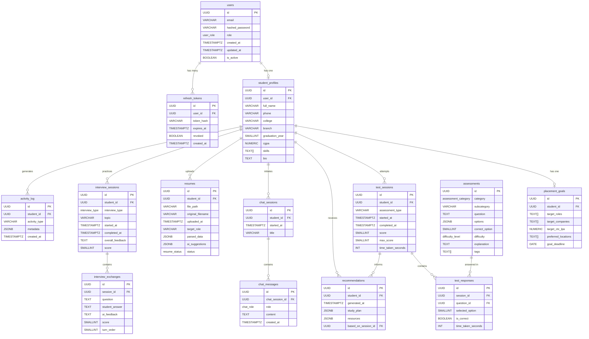

# Database Schema — AI-Powered Placement Coach

> **Database:** PostgreSQL 15+  
> **ORM:** SQLAlchemy (async) + Alembic  
> **Auth:** JWT + refresh tokens (no Redis)

---

## Table of Contents

1. [ERD Overview](#erd-overview)
2. [ENUM Types](#enum-types)
3. [Tables](#tables)
   - [users](#1-users)
   - [student_profiles](#2-student_profiles)
   - [placement_goals](#3-placement_goals)
   - [refresh_tokens](#4-refresh_tokens)
   - [assessments](#5-assessments)
   - [test_sessions](#6-test_sessions)
   - [test_responses](#7-test_responses)
   - [recommendations](#8-recommendations)
   - [chat_sessions](#9-chat_sessions)
   - [chat_messages](#10-chat_messages)
   - [resumes](#11-resumes)
   - [interview_sessions](#12-interview_sessions)
   - [interview_exchanges](#13-interview_exchanges)
   - [activity_log](#14-activity_log)
4. [JSONB Column Schemas](#jsonb-column-schemas)
5. [Alembic Migration Strategy](#alembic-migration-strategy)

---

## ERD Overview



---

## ENUM Types

Define these custom types before creating tables:

```sql
CREATE TYPE user_role            AS ENUM ('student', 'admin');
CREATE TYPE assessment_category  AS ENUM ('aptitude', 'technical');
CREATE TYPE difficulty_level     AS ENUM ('easy', 'medium', 'hard');
CREATE TYPE chat_role            AS ENUM ('user', 'assistant');
CREATE TYPE resume_status        AS ENUM ('pending', 'processing', 'done', 'failed');
CREATE TYPE interview_type       AS ENUM ('technical', 'hr');
```

---

## Tables

---

### 1. `users`

**Purpose:** Core authentication identity record. One row per registered account. Decoupled from profile data intentionally to keep auth logic clean.

| Column | Type | Constraints | Description |
|---|---|---|---|
| `id` | `UUID` | `PK, DEFAULT gen_random_uuid()` | Surrogate primary key |
| `email` | `VARCHAR(255)` | `NOT NULL, UNIQUE` | Login email address |
| `hashed_password` | `VARCHAR(255)` | `NOT NULL` | Bcrypt hash of the password |
| `role` | `user_role` | `NOT NULL, DEFAULT 'student'` | ENUM: `student` or `admin` |
| `created_at` | `TIMESTAMPTZ` | `NOT NULL, DEFAULT NOW()` | Account creation timestamp |
| `updated_at` | `TIMESTAMPTZ` | `NOT NULL, DEFAULT NOW()` | Last update timestamp (trigger-maintained) |
| `is_active` | `BOOLEAN` | `NOT NULL, DEFAULT TRUE` | Soft-disable flag for banned/deactivated accounts |

**Indexes:**
```sql
CREATE UNIQUE INDEX uq_users_email ON users (email);
CREATE INDEX idx_users_role ON users (role);
```

**DDL:**
```sql
CREATE TABLE users (
    id              UUID PRIMARY KEY DEFAULT gen_random_uuid(),
    email           VARCHAR(255) NOT NULL UNIQUE,
    hashed_password VARCHAR(255) NOT NULL,
    role            user_role    NOT NULL DEFAULT 'student',
    created_at      TIMESTAMPTZ  NOT NULL DEFAULT NOW(),
    updated_at      TIMESTAMPTZ  NOT NULL DEFAULT NOW(),
    is_active       BOOLEAN      NOT NULL DEFAULT TRUE
);
```

---

### 2. `student_profiles`

**Purpose:** Extended academic and personal information for a student. Separate from `users` to allow non-students (admins) in the system without null-heavy rows.

| Column | Type | Constraints | Description |
|---|---|---|---|
| `id` | `UUID` | `PK, DEFAULT gen_random_uuid()` | Surrogate primary key |
| `user_id` | `UUID` | `NOT NULL, UNIQUE, FK → users(id) ON DELETE CASCADE` | Owning user account |
| `full_name` | `VARCHAR(150)` | `NOT NULL` | Student's full name |
| `phone` | `VARCHAR(20)` | | Mobile number (E.164 or local) |
| `college` | `VARCHAR(255)` | | Institution name |
| `branch` | `VARCHAR(100)` | | Engineering/academic branch |
| `graduation_year` | `SMALLINT` | | Expected or actual graduation year |
| `cgpa` | `NUMERIC(4,2)` | `CHECK (cgpa >= 0 AND cgpa <= 10)` | CGPA on a 10-point scale |
| `skills` | `TEXT[]` | `NOT NULL, DEFAULT '{}'` | Array of self-reported skill strings |
| `bio` | `TEXT` | | Free-text personal statement |

**Indexes:**
```sql
CREATE UNIQUE INDEX uq_student_profiles_user_id ON student_profiles (user_id);
CREATE INDEX idx_student_profiles_graduation_year ON student_profiles (graduation_year);
CREATE INDEX idx_student_profiles_skills ON student_profiles USING GIN (skills);
```

**DDL:**
```sql
CREATE TABLE student_profiles (
    id              UUID         PRIMARY KEY DEFAULT gen_random_uuid(),
    user_id         UUID         NOT NULL UNIQUE REFERENCES users(id) ON DELETE CASCADE,
    full_name       VARCHAR(150) NOT NULL,
    phone           VARCHAR(20),
    college         VARCHAR(255),
    branch          VARCHAR(100),
    graduation_year SMALLINT,
    cgpa            NUMERIC(4,2) CHECK (cgpa >= 0 AND cgpa <= 10),
    skills          TEXT[]       NOT NULL DEFAULT '{}',
    bio             TEXT
);
```

---

### 3. `placement_goals`

**Purpose:** A student's placement targets. One-to-one with `student_profiles`; replaces previous row on update rather than appending history.

| Column | Type | Constraints | Description |
|---|---|---|---|
| `id` | `UUID` | `PK, DEFAULT gen_random_uuid()` | Surrogate primary key |
| `student_id` | `UUID` | `NOT NULL, UNIQUE, FK → student_profiles(id) ON DELETE CASCADE` | Owning student profile |
| `target_roles` | `TEXT[]` | `NOT NULL, DEFAULT '{}'` | Desired job titles (e.g., `['SDE-1','Data Engineer']`) |
| `target_companies` | `TEXT[]` | `NOT NULL, DEFAULT '{}'` | Desired companies |
| `target_ctc_lpa` | `NUMERIC(6,2)` | `CHECK (target_ctc_lpa >= 0)` | Target annual CTC in LPA |
| `preferred_locations` | `TEXT[]` | `NOT NULL, DEFAULT '{}'` | Preferred work cities/regions |
| `goal_deadline` | `DATE` | | Date by which placement is desired |

**Indexes:**
```sql
CREATE UNIQUE INDEX uq_placement_goals_student_id ON placement_goals (student_id);
CREATE INDEX idx_placement_goals_target_roles ON placement_goals USING GIN (target_roles);
CREATE INDEX idx_placement_goals_target_companies ON placement_goals USING GIN (target_companies);
```

**DDL:**
```sql
CREATE TABLE placement_goals (
    id                  UUID         PRIMARY KEY DEFAULT gen_random_uuid(),
    student_id          UUID         NOT NULL UNIQUE REFERENCES student_profiles(id) ON DELETE CASCADE,
    target_roles        TEXT[]       NOT NULL DEFAULT '{}',
    target_companies    TEXT[]       NOT NULL DEFAULT '{}',
    target_ctc_lpa      NUMERIC(6,2) CHECK (target_ctc_lpa >= 0),
    preferred_locations TEXT[]       NOT NULL DEFAULT '{}',
    goal_deadline       DATE
);
```

---

### 4. `refresh_tokens`

**Purpose:** Stores hashed refresh tokens for JWT rotation. No Redis dependency; expired or revoked tokens are purged by a scheduled job.

| Column | Type | Constraints | Description |
|---|---|---|---|
| `id` | `UUID` | `PK, DEFAULT gen_random_uuid()` | Surrogate primary key |
| `user_id` | `UUID` | `NOT NULL, FK → users(id) ON DELETE CASCADE` | Token owner |
| `token_hash` | `VARCHAR(255)` | `NOT NULL, UNIQUE` | SHA-256 hex digest of the raw refresh token |
| `expires_at` | `TIMESTAMPTZ` | `NOT NULL` | Absolute expiry timestamp |
| `revoked` | `BOOLEAN` | `NOT NULL, DEFAULT FALSE` | Set `TRUE` on logout or rotation |
| `created_at` | `TIMESTAMPTZ` | `NOT NULL, DEFAULT NOW()` | Issuance timestamp |

**Indexes:**
```sql
CREATE INDEX idx_refresh_tokens_user_id ON refresh_tokens (user_id);
CREATE INDEX idx_refresh_tokens_expires_at ON refresh_tokens (expires_at)
    WHERE revoked = FALSE;
```

> **Tip:** Run a nightly `DELETE FROM refresh_tokens WHERE expires_at < NOW() OR revoked = TRUE;` to keep this table small.

**DDL:**
```sql
CREATE TABLE refresh_tokens (
    id          UUID         PRIMARY KEY DEFAULT gen_random_uuid(),
    user_id     UUID         NOT NULL REFERENCES users(id) ON DELETE CASCADE,
    token_hash  VARCHAR(255) NOT NULL UNIQUE,
    expires_at  TIMESTAMPTZ  NOT NULL,
    revoked     BOOLEAN      NOT NULL DEFAULT FALSE,
    created_at  TIMESTAMPTZ  NOT NULL DEFAULT NOW()
);
```

---

### 5. `assessments`

**Purpose:** Question bank for aptitude and technical MCQ assessments. Shared across all student test sessions.

| Column | Type | Constraints | Description |
|---|---|---|---|
| `id` | `UUID` | `PK, DEFAULT gen_random_uuid()` | Surrogate primary key |
| `category` | `assessment_category` | `NOT NULL` | Top-level category: `aptitude` or `technical` |
| `subcategory` | `VARCHAR(100)` | `NOT NULL` | E.g., `quantitative`, `data-structures`, `os`, `dbms` |
| `question` | `TEXT` | `NOT NULL` | Full question text (may include markdown/code blocks) |
| `options` | `JSONB` | `NOT NULL` | Array of 4 option strings; see [JSONB schemas](#assessments-options) |
| `correct_option` | `SMALLINT` | `NOT NULL, CHECK (correct_option BETWEEN 0 AND 3)` | 0-indexed index into `options` array |
| `difficulty` | `difficulty_level` | `NOT NULL` | `easy`, `medium`, or `hard` |
| `explanation` | `TEXT` | | Post-answer explanation shown after submission |
| `tags` | `TEXT[]` | `NOT NULL, DEFAULT '{}'` | Fine-grained tags (e.g., `['binary-search','arrays']`) |

**Indexes:**
```sql
CREATE INDEX idx_assessments_category ON assessments (category);
CREATE INDEX idx_assessments_subcategory ON assessments (subcategory);
CREATE INDEX idx_assessments_difficulty ON assessments (difficulty);
CREATE INDEX idx_assessments_tags ON assessments USING GIN (tags);
```

**DDL:**
```sql
CREATE TABLE assessments (
    id             UUID                PRIMARY KEY DEFAULT gen_random_uuid(),
    category       assessment_category NOT NULL,
    subcategory    VARCHAR(100)        NOT NULL,
    question       TEXT                NOT NULL,
    options        JSONB               NOT NULL,
    correct_option SMALLINT            NOT NULL CHECK (correct_option BETWEEN 0 AND 3),
    difficulty     difficulty_level    NOT NULL,
    explanation    TEXT,
    tags           TEXT[]              NOT NULL DEFAULT '{}'
);
```

---

### 6. `test_sessions`

**Purpose:** Records one complete test attempt by a student. Groups individual responses and stores aggregate scores.

| Column | Type | Constraints | Description |
|---|---|---|---|
| `id` | `UUID` | `PK, DEFAULT gen_random_uuid()` | Surrogate primary key |
| `student_id` | `UUID` | `NOT NULL, FK → student_profiles(id) ON DELETE CASCADE` | Attempting student |
| `assessment_type` | `VARCHAR(100)` | `NOT NULL` | Logical test name, e.g., `aptitude-quant`, `technical-dsa` |
| `started_at` | `TIMESTAMPTZ` | `NOT NULL, DEFAULT NOW()` | When the session began |
| `completed_at` | `TIMESTAMPTZ` | | `NULL` if still in progress |
| `score` | `SMALLINT` | `CHECK (score >= 0)` | Number of correct answers |
| `max_score` | `SMALLINT` | `NOT NULL` | Total questions in the session |
| `time_taken_seconds` | `INT` | `CHECK (time_taken_seconds >= 0)` | Elapsed seconds from start to submit |

**Indexes:**
```sql
CREATE INDEX idx_test_sessions_student_id ON test_sessions (student_id);
CREATE INDEX idx_test_sessions_started_at ON test_sessions (started_at DESC);
CREATE INDEX idx_test_sessions_assessment_type ON test_sessions (assessment_type);
```

**DDL:**
```sql
CREATE TABLE test_sessions (
    id                  UUID         PRIMARY KEY DEFAULT gen_random_uuid(),
    student_id          UUID         NOT NULL REFERENCES student_profiles(id) ON DELETE CASCADE,
    assessment_type     VARCHAR(100) NOT NULL,
    started_at          TIMESTAMPTZ  NOT NULL DEFAULT NOW(),
    completed_at        TIMESTAMPTZ,
    score               SMALLINT     CHECK (score >= 0),
    max_score           SMALLINT     NOT NULL,
    time_taken_seconds  INT          CHECK (time_taken_seconds >= 0)
);
```

---

### 7. `test_responses`

**Purpose:** One row per question answered within a test session. Enables per-question analytics and replay.

| Column | Type | Constraints | Description |
|---|---|---|---|
| `id` | `UUID` | `PK, DEFAULT gen_random_uuid()` | Surrogate primary key |
| `session_id` | `UUID` | `NOT NULL, FK → test_sessions(id) ON DELETE CASCADE` | Parent test session |
| `question_id` | `UUID` | `NOT NULL, FK → assessments(id) ON DELETE RESTRICT` | The question answered |
| `selected_option` | `SMALLINT` | `CHECK (selected_option BETWEEN 0 AND 3)` | Student's chosen option index; `NULL` = skipped |
| `is_correct` | `BOOLEAN` | `NOT NULL` | Pre-computed correctness flag |
| `time_taken_seconds` | `INT` | `CHECK (time_taken_seconds >= 0)` | Time spent on this question |

**Indexes:**
```sql
CREATE INDEX idx_test_responses_session_id ON test_responses (session_id);
CREATE INDEX idx_test_responses_question_id ON test_responses (question_id);
CREATE UNIQUE INDEX uq_test_responses_session_question ON test_responses (session_id, question_id);
```

**DDL:**
```sql
CREATE TABLE test_responses (
    id                  UUID     PRIMARY KEY DEFAULT gen_random_uuid(),
    session_id          UUID     NOT NULL REFERENCES test_sessions(id) ON DELETE CASCADE,
    question_id         UUID     NOT NULL REFERENCES assessments(id) ON DELETE RESTRICT,
    selected_option     SMALLINT CHECK (selected_option BETWEEN 0 AND 3),
    is_correct          BOOLEAN  NOT NULL,
    time_taken_seconds  INT      CHECK (time_taken_seconds >= 0),
    UNIQUE (session_id, question_id)
);
```

---

### 8. `recommendations`

**Purpose:** AI-generated, per-student study plans and resource lists. Optionally linked to the triggering test session.

| Column | Type | Constraints | Description |
|---|---|---|---|
| `id` | `UUID` | `PK, DEFAULT gen_random_uuid()` | Surrogate primary key |
| `student_id` | `UUID` | `NOT NULL, FK → student_profiles(id) ON DELETE CASCADE` | Recipient student |
| `generated_at` | `TIMESTAMPTZ` | `NOT NULL, DEFAULT NOW()` | When the AI generated this recommendation |
| `study_plan` | `JSONB` | `NOT NULL` | Structured weekly plan; see [JSONB schemas](#recommendations-study_plan) |
| `resources` | `JSONB` | `NOT NULL` | Curated learning resources; see [JSONB schemas](#recommendations-resources) |
| `based_on_session_id` | `UUID` | `FK → test_sessions(id) ON DELETE SET NULL` | Optional: the session that triggered generation |

**Indexes:**
```sql
CREATE INDEX idx_recommendations_student_id ON recommendations (student_id);
CREATE INDEX idx_recommendations_generated_at ON recommendations (generated_at DESC);
CREATE INDEX idx_recommendations_session_id ON recommendations (based_on_session_id)
    WHERE based_on_session_id IS NOT NULL;
```

**DDL:**
```sql
CREATE TABLE recommendations (
    id                   UUID        PRIMARY KEY DEFAULT gen_random_uuid(),
    student_id           UUID        NOT NULL REFERENCES student_profiles(id) ON DELETE CASCADE,
    generated_at         TIMESTAMPTZ NOT NULL DEFAULT NOW(),
    study_plan           JSONB       NOT NULL,
    resources            JSONB       NOT NULL,
    based_on_session_id  UUID        REFERENCES test_sessions(id) ON DELETE SET NULL
);
```

---

### 9. `chat_sessions`

**Purpose:** Groups chat messages into named conversations for the AI placement chatbot.

| Column | Type | Constraints | Description |
|---|---|---|---|
| `id` | `UUID` | `PK, DEFAULT gen_random_uuid()` | Surrogate primary key |
| `student_id` | `UUID` | `NOT NULL, FK → student_profiles(id) ON DELETE CASCADE` | Session owner |
| `started_at` | `TIMESTAMPTZ` | `NOT NULL, DEFAULT NOW()` | Conversation start time |
| `title` | `VARCHAR(200)` | `NOT NULL, DEFAULT 'New Chat'` | Auto-generated or user-renamed title |

**Indexes:**
```sql
CREATE INDEX idx_chat_sessions_student_id ON chat_sessions (student_id);
CREATE INDEX idx_chat_sessions_started_at ON chat_sessions (started_at DESC);
```

**DDL:**
```sql
CREATE TABLE chat_sessions (
    id         UUID         PRIMARY KEY DEFAULT gen_random_uuid(),
    student_id UUID         NOT NULL REFERENCES student_profiles(id) ON DELETE CASCADE,
    started_at TIMESTAMPTZ  NOT NULL DEFAULT NOW(),
    title      VARCHAR(200) NOT NULL DEFAULT 'New Chat'
);
```

---

### 10. `chat_messages`

**Purpose:** Individual messages (user turns and assistant turns) within a chat session.

| Column | Type | Constraints | Description |
|---|---|---|---|
| `id` | `UUID` | `PK, DEFAULT gen_random_uuid()` | Surrogate primary key |
| `chat_session_id` | `UUID` | `NOT NULL, FK → chat_sessions(id) ON DELETE CASCADE` | Parent session |
| `role` | `chat_role` | `NOT NULL` | `user` (student) or `assistant` (AI) |
| `content` | `TEXT` | `NOT NULL` | Message body (may contain markdown) |
| `created_at` | `TIMESTAMPTZ` | `NOT NULL, DEFAULT NOW()` | Message send timestamp |

**Indexes:**
```sql
CREATE INDEX idx_chat_messages_chat_session_id ON chat_messages (chat_session_id);
CREATE INDEX idx_chat_messages_created_at ON chat_messages (chat_session_id, created_at ASC);
```

**DDL:**
```sql
CREATE TABLE chat_messages (
    id               UUID        PRIMARY KEY DEFAULT gen_random_uuid(),
    chat_session_id  UUID        NOT NULL REFERENCES chat_sessions(id) ON DELETE CASCADE,
    role             chat_role   NOT NULL,
    content          TEXT        NOT NULL,
    created_at       TIMESTAMPTZ NOT NULL DEFAULT NOW()
);
```

---

### 11. `resumes`

**Purpose:** Tracks uploaded resume files, AI parsing results, and role-specific improvement suggestions.

| Column | Type | Constraints | Description |
|---|---|---|---|
| `id` | `UUID` | `PK, DEFAULT gen_random_uuid()` | Surrogate primary key |
| `student_id` | `UUID` | `NOT NULL, FK → student_profiles(id) ON DELETE CASCADE` | Uploader |
| `file_path` | `VARCHAR(500)` | `NOT NULL` | Server-relative or object-store path to the file |
| `original_filename` | `VARCHAR(255)` | `NOT NULL` | Browser-supplied filename at upload time |
| `uploaded_at` | `TIMESTAMPTZ` | `NOT NULL, DEFAULT NOW()` | Upload timestamp |
| `target_role` | `VARCHAR(150)` | `NOT NULL` | Role the resume is being optimised for |
| `parsed_data` | `JSONB` | | Structured extraction; see [JSONB schemas](#resumes-parsed_data) |
| `ai_suggestions` | `JSONB` | | AI improvement notes; see [JSONB schemas](#resumes-ai_suggestions) |
| `status` | `resume_status` | `NOT NULL, DEFAULT 'pending'` | Processing pipeline state |

**Indexes:**
```sql
CREATE INDEX idx_resumes_student_id ON resumes (student_id);
CREATE INDEX idx_resumes_status ON resumes (status);
CREATE INDEX idx_resumes_uploaded_at ON resumes (uploaded_at DESC);
```

**DDL:**
```sql
CREATE TABLE resumes (
    id                UUID          PRIMARY KEY DEFAULT gen_random_uuid(),
    student_id        UUID          NOT NULL REFERENCES student_profiles(id) ON DELETE CASCADE,
    file_path         VARCHAR(500)  NOT NULL,
    original_filename VARCHAR(255)  NOT NULL,
    uploaded_at       TIMESTAMPTZ   NOT NULL DEFAULT NOW(),
    target_role       VARCHAR(150)  NOT NULL,
    parsed_data       JSONB,
    ai_suggestions    JSONB,
    status            resume_status NOT NULL DEFAULT 'pending'
);
```

---

### 12. `interview_sessions`

**Purpose:** Records one complete mock interview (technical or HR), storing overall AI feedback and aggregate score.

| Column | Type | Constraints | Description |
|---|---|---|---|
| `id` | `UUID` | `PK, DEFAULT gen_random_uuid()` | Surrogate primary key |
| `student_id` | `UUID` | `NOT NULL, FK → student_profiles(id) ON DELETE CASCADE` | Practicing student |
| `interview_type` | `interview_type` | `NOT NULL` | `technical` or `hr` |
| `topic` | `VARCHAR(150)` | `NOT NULL` | E.g., `System Design`, `HR Behavioural`, `DSA – Trees` |
| `started_at` | `TIMESTAMPTZ` | `NOT NULL, DEFAULT NOW()` | Session start |
| `completed_at` | `TIMESTAMPTZ` | | `NULL` if still in progress |
| `overall_feedback` | `TEXT` | | AI-generated holistic feedback after completion |
| `score` | `SMALLINT` | `CHECK (score BETWEEN 0 AND 100)` | Aggregate score out of 100 |

**Indexes:**
```sql
CREATE INDEX idx_interview_sessions_student_id ON interview_sessions (student_id);
CREATE INDEX idx_interview_sessions_type ON interview_sessions (interview_type);
CREATE INDEX idx_interview_sessions_started_at ON interview_sessions (started_at DESC);
```

**DDL:**
```sql
CREATE TABLE interview_sessions (
    id               UUID           PRIMARY KEY DEFAULT gen_random_uuid(),
    student_id       UUID           NOT NULL REFERENCES student_profiles(id) ON DELETE CASCADE,
    interview_type   interview_type NOT NULL,
    topic            VARCHAR(150)   NOT NULL,
    started_at       TIMESTAMPTZ    NOT NULL DEFAULT NOW(),
    completed_at     TIMESTAMPTZ,
    overall_feedback TEXT,
    score            SMALLINT       CHECK (score BETWEEN 0 AND 100)
);
```

---

### 13. `interview_exchanges`

**Purpose:** Individual question–answer turns within a mock interview session. Stores the AI question, student response, and per-turn AI feedback.

| Column | Type | Constraints | Description |
|---|---|---|---|
| `id` | `UUID` | `PK, DEFAULT gen_random_uuid()` | Surrogate primary key |
| `session_id` | `UUID` | `NOT NULL, FK → interview_sessions(id) ON DELETE CASCADE` | Parent session |
| `question` | `TEXT` | `NOT NULL` | AI-generated interview question |
| `student_answer` | `TEXT` | | Student's typed or transcribed answer |
| `ai_feedback` | `TEXT` | | Per-answer AI feedback |
| `score` | `SMALLINT` | `CHECK (score BETWEEN 0 AND 10)` | Per-question score out of 10 |
| `turn_order` | `SMALLINT` | `NOT NULL, CHECK (turn_order > 0)` | 1-based ordering within the session |

**Indexes:**
```sql
CREATE INDEX idx_interview_exchanges_session_id ON interview_exchanges (session_id);
CREATE UNIQUE INDEX uq_interview_exchanges_session_turn ON interview_exchanges (session_id, turn_order);
```

**DDL:**
```sql
CREATE TABLE interview_exchanges (
    id             UUID     PRIMARY KEY DEFAULT gen_random_uuid(),
    session_id     UUID     NOT NULL REFERENCES interview_sessions(id) ON DELETE CASCADE,
    question       TEXT     NOT NULL,
    student_answer TEXT,
    ai_feedback    TEXT,
    score          SMALLINT CHECK (score BETWEEN 0 AND 10),
    turn_order     SMALLINT NOT NULL CHECK (turn_order > 0),
    UNIQUE (session_id, turn_order)
);
```

---

### 14. `activity_log`

**Purpose:** Append-only event stream for the progress-tracking dashboard. One row per trackable student action.

| Column | Type | Constraints | Description |
|---|---|---|---|
| `id` | `UUID` | `PK, DEFAULT gen_random_uuid()` | Surrogate primary key |
| `student_id` | `UUID` | `NOT NULL, FK → student_profiles(id) ON DELETE CASCADE` | Acting student |
| `activity_type` | `VARCHAR(80)` | `NOT NULL` | Discriminator string; see canonical values below |
| `metadata` | `JSONB` | `NOT NULL, DEFAULT '{}'` | Activity-specific payload; see [JSONB schemas](#activity_log-metadata) |
| `created_at` | `TIMESTAMPTZ` | `NOT NULL, DEFAULT NOW()` | Event timestamp |

**Canonical `activity_type` values:**

| Value | Trigger |
|---|---|
| `test_completed` | Student submits a test session |
| `resume_uploaded` | New resume file accepted |
| `interview_completed` | Mock interview session ends |
| `chat_started` | New chat session opened |
| `profile_updated` | Student profile or goal changed |
| `recommendation_viewed` | Student opens a recommendation card |

**Indexes:**
```sql
CREATE INDEX idx_activity_log_student_id ON activity_log (student_id);
CREATE INDEX idx_activity_log_created_at ON activity_log (student_id, created_at DESC);
CREATE INDEX idx_activity_log_activity_type ON activity_log (activity_type);
```

**DDL:**
```sql
CREATE TABLE activity_log (
    id            UUID         PRIMARY KEY DEFAULT gen_random_uuid(),
    student_id    UUID         NOT NULL REFERENCES student_profiles(id) ON DELETE CASCADE,
    activity_type VARCHAR(80)  NOT NULL,
    metadata      JSONB        NOT NULL DEFAULT '{}',
    created_at    TIMESTAMPTZ  NOT NULL DEFAULT NOW()
);
```

---

## JSONB Column Schemas

All JSONB fields are validated at the application layer (Pydantic models) before insertion. PostgreSQL CHECK constraints using `jsonb_typeof` are noted where appropriate.

---

### `assessments.options`

Exactly 4 option strings, always an array.

```json
["Option A text", "Option B text", "Option C text", "Option D text"]
```

| Field | Type | Required | Description |
|---|---|---|---|
| `[0..3]` | `string` | Yes | Option display text (index matches `correct_option`) |

---

### `recommendations.study_plan`

```json
{
  "weeks": [
    {
      "week_number": 1,
      "focus": "Data Structures Basics",
      "daily_goals": [
        {"day": "Monday", "tasks": ["Revise arrays", "Solve 5 LeetCode easy problems"]},
        {"day": "Tuesday", "tasks": ["Linked lists theory", "Implement singly linked list"]}
      ],
      "estimated_hours": 12
    }
  ],
  "total_weeks": 6,
  "summary": "Focus on core DSA before moving to system design."
}
```

| Field | Type | Required | Description |
|---|---|---|---|
| `weeks` | `array` | Yes | Ordered list of weekly plan objects |
| `weeks[].week_number` | `integer` | Yes | 1-based week index |
| `weeks[].focus` | `string` | Yes | Theme or topic for the week |
| `weeks[].daily_goals` | `array` | Yes | Per-day task lists |
| `weeks[].daily_goals[].day` | `string` | Yes | Day name |
| `weeks[].daily_goals[].tasks` | `string[]` | Yes | List of action items |
| `weeks[].estimated_hours` | `number` | No | Expected study hours for the week |
| `total_weeks` | `integer` | Yes | Plan duration in weeks |
| `summary` | `string` | Yes | Human-readable plan overview |

---

### `recommendations.resources`

```json
{
  "categories": [
    {
      "name": "DSA",
      "items": [
        {
          "title": "Striver's A2Z DSA Sheet",
          "url": "https://takeuforward.org/strivers-a2z-dsa-course",
          "type": "course",
          "difficulty": "medium",
          "estimated_hours": 80
        }
      ]
    }
  ]
}
```

| Field | Type | Required | Description |
|---|---|---|---|
| `categories` | `array` | Yes | Grouped resource lists |
| `categories[].name` | `string` | Yes | Category label (e.g., `DSA`, `System Design`, `Aptitude`) |
| `categories[].items` | `array` | Yes | Resource entries |
| `categories[].items[].title` | `string` | Yes | Display name |
| `categories[].items[].url` | `string` | Yes | Canonical URL |
| `categories[].items[].type` | `string` | Yes | One of: `video`, `course`, `article`, `book`, `practice` |
| `categories[].items[].difficulty` | `string` | No | `easy`, `medium`, or `hard` |
| `categories[].items[].estimated_hours` | `number` | No | Time investment estimate in hours |

---

### `resumes.parsed_data`

```json
{
  "contact": {
    "name": "Riya Sharma",
    "email": "riya@example.com",
    "phone": "+91-9876543210",
    "linkedin": "https://linkedin.com/in/riyasharma",
    "github": "https://github.com/riyasharma"
  },
  "education": [
    {
      "institution": "NIT Trichy",
      "degree": "B.Tech",
      "branch": "Computer Science",
      "cgpa": 8.7,
      "graduation_year": 2025
    }
  ],
  "experience": [
    {
      "company": "Infosys",
      "role": "SDE Intern",
      "duration_months": 6,
      "description": "Worked on microservices using Spring Boot."
    }
  ],
  "projects": [
    {
      "name": "PlacementBot",
      "description": "AI chatbot for student placement prep.",
      "tech_stack": ["Python", "FastAPI", "PostgreSQL"],
      "url": "https://github.com/riyasharma/placementbot"
    }
  ],
  "skills": ["Python", "FastAPI", "PostgreSQL", "Docker"],
  "certifications": ["AWS Cloud Practitioner", "Google Data Analytics"],
  "raw_text": "Full plain-text content of the resume..."
}
```

| Field | Type | Description |
|---|---|---|
| `contact` | `object` | Extracted contact information |
| `education` | `array` | Educational qualifications |
| `experience` | `array` | Internship/work experience entries |
| `projects` | `array` | Personal and academic projects |
| `skills` | `string[]` | Extracted skill keywords |
| `certifications` | `string[]` | Certification names |
| `raw_text` | `string` | Full plain-text content for re-parsing |

---

### `resumes.ai_suggestions`

```json
{
  "overall_score": 72,
  "target_role": "Backend Engineer",
  "strengths": ["Strong project section", "Relevant internship experience"],
  "weaknesses": ["Missing quantified achievements", "No open-source contributions listed"],
  "section_feedback": {
    "summary": "Add a 3-line professional summary at the top.",
    "skills": "Add Docker, Kubernetes to skills; they are required for target role.",
    "experience": "Quantify impact: replace 'worked on' with 'reduced latency by 30%'.",
    "projects": "Add GitHub links and live demo URLs."
  },
  "keywords_missing": ["REST API", "CI/CD", "Kafka"],
  "ats_score": 65
}
```

| Field | Type | Description |
|---|---|---|
| `overall_score` | `integer 0–100` | Composite resume quality score |
| `target_role` | `string` | Role the resume is evaluated against |
| `strengths` | `string[]` | Positive aspects identified |
| `weaknesses` | `string[]` | Areas needing improvement |
| `section_feedback` | `object` | Keyed by resume section name |
| `keywords_missing` | `string[]` | Role-critical keywords absent from the resume |
| `ats_score` | `integer 0–100` | Estimated ATS pass-through score |

---

### `activity_log.metadata`

Shape varies by `activity_type`:

**`test_completed`**
```json
{"session_id": "uuid", "assessment_type": "technical-dsa", "score": 18, "max_score": 25}
```

**`resume_uploaded`**
```json
{"resume_id": "uuid", "original_filename": "riya_resume_v3.pdf", "target_role": "Backend Engineer"}
```

**`interview_completed`**
```json
{"session_id": "uuid", "interview_type": "technical", "topic": "DSA - Trees", "score": 74}
```

**`chat_started`**
```json
{"chat_session_id": "uuid", "title": "How to prep for FAANG?"}
```

**`profile_updated`**
```json
{"fields_changed": ["cgpa", "skills", "bio"]}
```

**`recommendation_viewed`**
```json
{"recommendation_id": "uuid", "generated_at": "2025-06-01T10:00:00Z"}
```

---

## Alembic Migration Strategy

### Setup

```bash
alembic init alembic
```

Configure `alembic/env.py` for async SQLAlchemy:

```python
from sqlalchemy.ext.asyncio import async_engine_from_config

def run_migrations_online():
    connectable = async_engine_from_config(
        config.get_section(config.config_ini_section),
        prefix="sqlalchemy.",
    )
    # use connectable.connect() inside asynccontextmanager
```

Set `sqlalchemy.url` in `alembic.ini` (or override via env var `DATABASE_URL`).

### Revision Workflow

```bash
# Generate a new migration after model changes
alembic revision --autogenerate -m "describe_change"

# Inspect and edit the generated script in alembic/versions/

# Apply to target database
alembic upgrade head

# Roll back one step
alembic downgrade -1
```

### Ordering Rules

1. **ENUM types first** — Create all custom ENUM types in an initial migration or directly in `env.py` before any table that references them. Alembic autogenerate does **not** reliably detect ENUM changes; manage them manually using `sa.Enum(..., create_type=True)` / `DROP TYPE`.
2. **Dependency order for `upgrade`:**  
   `users` → `student_profiles` → `placement_goals` → `refresh_tokens` → `assessments` → `test_sessions` → `test_responses` → `recommendations` → `chat_sessions` → `chat_messages` → `resumes` → `interview_sessions` → `interview_exchanges` → `activity_log`
3. **Reverse for `downgrade`** — Drop child tables before parents; drop ENUM types last.
4. **JSONB schema changes** — No migration required for JSONB internal structure changes. Update Pydantic validation models in the application layer only.
5. **Index migrations** — Always name indexes explicitly (as shown above) so Alembic can diff them correctly. Prefer `CREATE INDEX CONCURRENTLY` in production migration scripts to avoid table locks on live data.

> **Important:** Never run `alembic stamp head` on a production database without verifying the actual schema matches the target revision. Always execute `alembic check` in CI before deploying.

> **Warning:** Alembic autogenerate does **not** detect: ENUM type creation/deletion, `CHECK` constraint changes, or GIN index creation. These must be written manually in the migration script's `upgrade()` and `downgrade()` functions.
