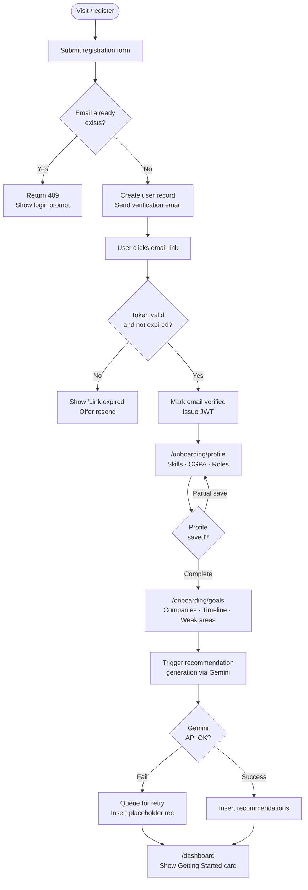
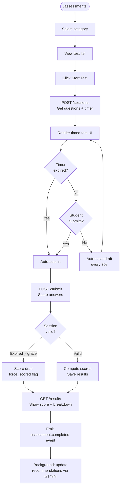
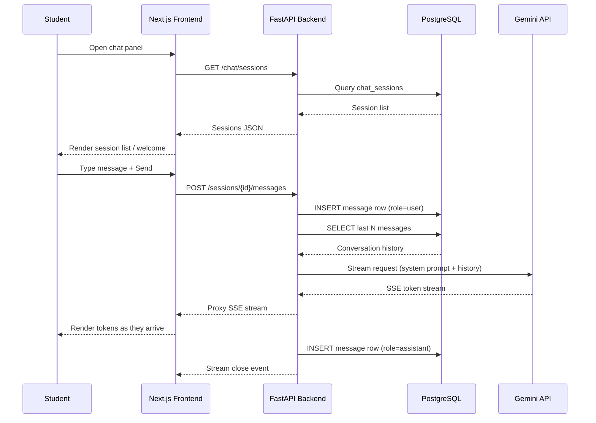
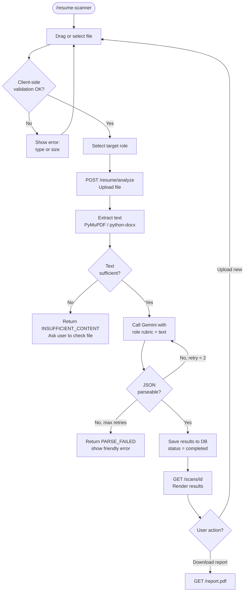
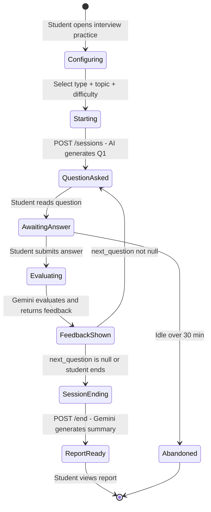
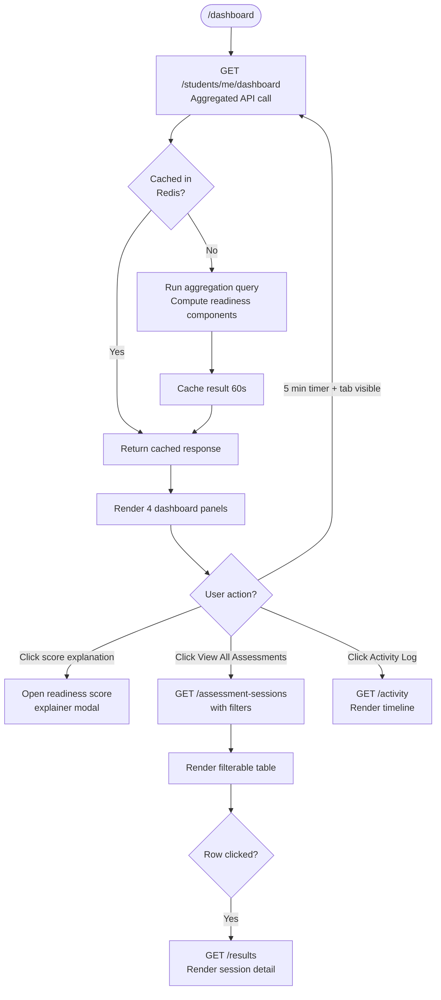

# Feature Workflows — AI-Powered Placement Coach

> **Stack:** Next.js 14+ (App Router) · FastAPI · PostgreSQL · Google Gemini API · JWT Auth  
> **Audience:** Developers implementing these features. Each section is self-contained.

---

## Table of Contents

1. [Onboarding Flow](#1-onboarding-flow)
2. [Assessment Flow](#2-assessment-flow)
3. [AI Chatbot Flow](#3-ai-chatbot-flow)
4. [Resume Scanner Flow](#4-resume-scanner-flow)
5. [Interview Practice Flow](#5-interview-practice-flow)
6. [Progress Dashboard Flow](#6-progress-dashboard-flow)

---

## 1. Onboarding Flow

### Purpose
Guide a new student from registration through profile setup, placement goal definition, and delivery of their first personalized recommendations. This is a single linear funnel — partial completion is saved at each step so users can resume.

### User Workflow

1. Student visits `/register` and submits: full name, email, password, college name, branch, graduation year.
2. System sends a verification email. Student clicks the link.
3. Student is redirected to `/onboarding/profile` and fills in: skills (multi-select), current CGPA, preferred job roles (up to 3), work experience (internships/projects).
4. Student proceeds to `/onboarding/goals` and selects: target companies (from a predefined list or free-text), placement timeline (immediate / 3 months / 6 months), weak areas (self-assessed checklist).
5. System processes the profile and goals to generate a personalized study plan.
6. Student is redirected to `/dashboard` and sees a "Getting Started" card with their first recommendation batch.

### Backend Actions per Step

| Step | Endpoint | Action |
|------|----------|--------|
| 1 — Register | `POST /api/auth/register` | Hash password (bcrypt), insert `users` row, generate email verification token, enqueue verification email via background task |
| 2 — Verify email | `GET /api/auth/verify-email?token=…` | Validate token expiry (24 h), mark `users.email_verified = true`, issue short-lived JWT + refresh token |
| 3 — Profile | `PATCH /api/students/me/profile` | Upsert `student_profiles` row; store skills as `text[]`, partial-save supported via `onboarding_step` enum column |
| 4 — Goals | `PATCH /api/students/me/goals` | Upsert `placement_goals` row; advance `onboarding_step` to `goals_complete` |
| 5 — Generate plan | Internal task triggered after step 4 | Compose prompt from profile + goals → call Gemini API → parse structured JSON response → insert rows into `recommendations` table |
| 6 — Dashboard | `GET /api/students/me/recommendations?limit=5` | Return first recommendation batch ordered by priority score |

### Edge Cases & Error Handling

| Scenario | Handling |
|----------|----------|
| Email already registered | `POST /register` returns `409 Conflict`; frontend shows "Account exists — log in instead" |
| Verification link expired | Re-send verification endpoint `POST /api/auth/resend-verification` (rate-limited: 3/hour) |
| User closes browser mid-onboarding | `onboarding_step` persisted in DB; JWT middleware redirects authenticated users with incomplete onboarding back to the correct step |
| Gemini API failure during plan generation | Retry up to 3× with exponential backoff; if all fail, insert placeholder recommendation row with `status = pending_generation`; background job retries every 15 min |
| Student selects contradictory goals (e.g., FAANG + 0 DSA skills + 1-month timeline) | Allowed — recommendation engine factors in gap; adds high-priority DSA track |

### Workflow Diagram



---

## 2. Assessment Flow

### Purpose
Allow students to take timed aptitude and technical assessments (DSA, DBMS, OS, Aptitude, etc.), submit answers, receive scored results, and automatically trigger a re-ranking of their personalized recommendations.

### User Workflow

1. Student navigates to `/assessments` and sees a grid of categories (Aptitude, DSA, DBMS, OS, System Design, etc.).
2. Student selects a category and views available tests (difficulty: Easy / Medium / Hard).
3. Student clicks **Start Test**. A confirmation modal shows: question count, time limit, rules.
4. Test begins. Student sees one question at a time (or all questions paginated) with a countdown timer in the header.
5. Student answers questions (MCQ / code snippet selection). Answers auto-saved locally every 30 seconds.
6. Student clicks **Submit** (or timer reaches 0 — auto-submit triggers).
7. Results page loads: overall score, per-topic breakdown, correct/incorrect answers with explanations.
8. System triggers recommendation update in the background.

### Backend Actions per Step

| Step | Endpoint | Action |
|------|----------|--------|
| 2 — List tests | `GET /api/assessments?category=DSA` | Query `assessments` table filtered by category; return metadata (no questions yet) |
| 3 — Start test | `POST /api/assessments/{id}/sessions` | Create `assessment_sessions` row with `started_at`, generate a signed session token encoding `{session_id, expires_at}`; return questions with shuffled option order (seed stored server-side) |
| 5 — Auto-save | `PUT /api/assessment-sessions/{session_id}/draft` | Store `answers_draft` JSONB in session row; no scoring |
| 6 — Submit | `POST /api/assessment-sessions/{session_id}/submit` | Validate session not expired; score answers against `question_answers` table; compute `score`, `topic_scores`; update session `status = completed`; emit `assessment.completed` event |
| 7 — Results | `GET /api/assessment-sessions/{session_id}/results` | Return scored session with explanations joined from `questions.explanation` |
| 8 — Reco update | Background consumer of `assessment.completed` event | Re-score student's weak areas; call Gemini to reprioritize recommendations; upsert `recommendations` |

### Edge Cases & Error Handling

| Scenario | Handling |
|----------|----------|
| Timer reaches 0 | Client fires `POST /submit` automatically; server also accepts late submissions within a 10-second grace window (clock skew) |
| Submit after session expired (> grace window) | `POST /submit` returns `410 Gone`; last saved draft is scored as final with a `force_scored` flag |
| Network loss mid-test | Answers stored in `localStorage`; reconnection syncs draft via `PUT /draft`; UI shows offline indicator |
| Student attempts same test twice | Check `assessment_sessions` for existing completed session; allow retake, but track attempt number; use best score for recommendations |
| Gemini reco update fails | Non-blocking — test result is shown immediately; reco update retried asynchronously |
| Cheating / tab switch detection | `visibilitychange` events logged to `session_events` table; threshold violations flagged on session row (`integrity_flag = true`) |

### Workflow Diagram



---

## 3. AI Chatbot Flow

### Purpose
Provide a persistent, session-aware placement coaching chatbot powered by Gemini. Supports general placement Q&A, company-specific advice, and contextual suggestions based on the student's profile.

### User Workflow

1. Student clicks the chat icon (available on all pages via a floating button).
2. Chat drawer/panel opens. If no prior session, a welcome message is shown.
3. Student types a message and presses **Send**.
4. A loading indicator appears while the backend calls Gemini.
5. The AI reply streams in token-by-token (or arrives as a complete message if streaming is disabled).
6. Student can continue the conversation. Session history is persisted.
7. Student can click **New Chat** to start a fresh session (previous sessions accessible via a history list).

### Backend Actions per Step

| Step | Endpoint | Action |
|------|----------|--------|
| 2 — Load chat | `GET /api/chat/sessions?limit=20` | Return list of past sessions with last message preview |
| 2 — New session | `POST /api/chat/sessions` | Create `chat_sessions` row with a system prompt that injects student profile context (skills, goals, weak areas) |
| 3–5 — Send message | `POST /api/chat/sessions/{id}/messages` | Persist user message; build conversation history (last N turns trimmed to token budget); call `gemini-1.5-pro` with `stream=true`; proxy SSE stream to client; persist final assistant message on stream close |
| 6 — Load history | `GET /api/chat/sessions/{id}/messages?page=1` | Return paginated messages for a session |

### System Prompt Construction

```
You are an AI placement coach for engineering students in India.
Student context:
  - Branch: {branch}, Graduation: {year}
  - Target roles: {roles}
  - Target companies: {companies}
  - Weak areas: {weak_areas}
  - Assessment scores: {recent_scores_summary}

Answer placement-related questions clearly and concisely.
If the student asks about topics outside campus placements, politely redirect.
Always suggest next steps the student can take within the app.
```

The context block is regenerated fresh on each `POST /sessions` call to reflect the latest profile data.

### Edge Cases & Error Handling

| Scenario | Handling |
|----------|----------|
| Gemini API timeout (> 30 s) | SSE stream sends an error event; frontend shows "Response timed out — try again" with a Retry button |
| Token limit exceeded (context too long) | Sliding window: keep system prompt + last 10 turns; summarize older turns via a Gemini summarization call first |
| Student sends empty message | Blocked client-side; if bypassed, `POST /messages` returns `422 Unprocessable Entity` |
| Offensive content in message | Gemini's built-in safety filters apply; if blocked, return a standardized "I can't help with that" message |
| Session has no messages yet | System sends a canned welcome + 3 suggested starter questions based on student profile |
| Network drop during streaming | Client detects SSE connection drop; shows partial response with a "Connection lost" notice; student can re-send |

### Workflow Diagram



---

## 4. Resume Scanner Flow

### Purpose
Accept a student's resume (PDF/DOCX), let them select a target role, and return a structured analysis with ATS score, keyword gaps, formatting issues, and role-specific improvement suggestions.

### User Workflow

1. Student navigates to `/resume-scanner`.
2. Student drags and drops (or selects) a resume file (PDF or DOCX, max 5 MB).
3. Client-side validation runs (file type, size).
4. Student selects a target role from a dropdown (e.g., "SDE", "Data Analyst", "ML Engineer").
5. Student clicks **Analyze**.
6. A progress indicator cycles through states: *Uploading → Extracting text → Analyzing with AI → Generating suggestions*.
7. Results page renders with:
   - **ATS Compatibility Score** (0–100)
   - **Keyword Match** section (present / missing keywords for the role)
   - **Section-by-section Feedback** (Summary, Experience, Skills, Education)
   - **Top 5 Actionable Suggestions** ordered by impact
8. Student can download a PDF report or go back to upload a revised resume.

### Backend Actions per Step

| Step | Endpoint | Action |
|------|----------|--------|
| 5 — Upload + Analyze | `POST /api/resume/analyze` (multipart) | Validate file type + size; save to temp storage; extract text (PyMuPDF for PDF, python-docx for DOCX); create `resume_scans` row with `status = processing` |
| 6 — Processing pipeline | Internal async task | Text → clean/normalize → build Gemini prompt with role-specific rubric → call Gemini → parse structured JSON response → update `resume_scans` row with results + `status = completed` |
| 6 — Polling | `GET /api/resume/scans/{scan_id}/status` | Return `{status, progress_stage}`; client polls every 2 s |
| 7 — Results | `GET /api/resume/scans/{scan_id}` | Return full analysis JSON |
| 8 — PDF report | `GET /api/resume/scans/{scan_id}/report.pdf` | Generate PDF from stored JSON using WeasyPrint or ReportLab; stream response |

### Gemini Prompt Structure

```
You are an expert ATS resume analyzer and technical recruiter.

Target Role: {role}
Required Keywords for this role: {role_keywords_list}

Resume Text:
---
{extracted_text}
---

Respond ONLY with a valid JSON object matching this schema:
{
  "ats_score": integer (0-100),
  "keyword_match": { "present": [str], "missing": [str] },
  "section_feedback": {
    "summary": str,
    "experience": str,
    "skills": str,
    "education": str
  },
  "suggestions": [{ "priority": int, "area": str, "suggestion": str }]
}
```

### Edge Cases & Error Handling

| Scenario | Handling |
|----------|----------|
| Unsupported file type | Client blocks before upload; API returns `415 Unsupported Media Type` as fallback |
| File > 5 MB | Client-side validation shows error; API also enforces with `413 Payload Too Large` |
| Password-protected PDF | PyMuPDF raises exception → `resume_scans.status = failed`, `error_code = PASSWORD_PROTECTED` |
| Gemini returns malformed JSON | Backend retries prompt with stricter instruction up to 2×; if still invalid, return `error_code = PARSE_FAILED` with a user-friendly message |
| Empty or near-empty resume text (< 100 chars) | Skip Gemini call; return `error_code = INSUFFICIENT_CONTENT` |
| Processing takes > 60 s | Mark scan as `status = timeout`; user shown "Analysis timed out" with a retry option |
| User uploads the same file twice | Check SHA-256 hash of file content; if existing completed scan found, return cached result immediately |

### Workflow Diagram



---

## 5. Interview Practice Flow

### Purpose
Simulate real technical and HR interviews. The AI (Gemini) acts as an interviewer: asks questions, evaluates student answers, gives immediate feedback, then asks the next question. Sessions end with a full performance report.

### User Workflow

1. Student navigates to `/interview-practice`.
2. Student selects interview **type**: Technical or HR.
   - Technical: also selects a **topic** (DSA, System Design, DBMS, OS, Core CS, etc.).
   - HR: chooses a **context** (General HR, Company-specific, Behavioral).
3. Student selects **difficulty**: Beginner / Intermediate / Advanced.
4. Student clicks **Start Interview**.
5. AI asks the first question (displayed in a chat-like interface).
6. Student types their answer and clicks **Submit Answer**.
7. AI returns:
   - ✅ **Feedback** on the answer (what was correct, what was missing, ideal answer summary)
   - ➡️ **Next question** (or session end trigger if question count reached)
8. After the final question (default: 5 questions per session), student clicks **End Session**.
9. Session report page shows: overall performance rating (1–5), per-question scores, key strengths, areas for improvement, and suggested topics to revise.

### Backend Actions per Step

| Step | Endpoint | Action |
|------|----------|--------|
| 4 — Start | `POST /api/interview/sessions` | Create `interview_sessions` row; build opening system prompt (type, topic, difficulty, student profile); call Gemini for first question; return question |
| 6 — Submit answer | `POST /api/interview/sessions/{id}/answers` | Append `{question, student_answer}` to session turn history; build evaluation prompt; call Gemini; parse `{feedback, score, next_question}`; persist turn; return response |
| 8 — End session | `POST /api/interview/sessions/{id}/end` | Mark session `status = completed`; call Gemini with full transcript for a final performance summary; store report |
| 9 — View report | `GET /api/interview/sessions/{id}/report` | Return stored report JSON |

### Gemini Turn Prompt Structure

**Evaluation + Next Question Prompt:**
```
You are a {type} interviewer for {topic} at {difficulty} level.

Conversation so far:
{turn_history_json}

The student's latest answer:
"{student_answer}"

Evaluate the answer and respond ONLY with valid JSON:
{
  "feedback": str,           // 2-4 sentences: what was good, what was missing
  "score": int,              // 1-5 for this answer
  "model_answer_hint": str,  // key points of an ideal answer
  "next_question": str | null   // null if this was the final question
}

Questions asked so far: {n}. Session limit: 5.
If {n} == 5, set next_question to null.
```

### Edge Cases & Error Handling

| Scenario | Handling |
|----------|----------|
| Student submits a blank answer | Client prevents submission; if bypassed, Gemini is not called — return `{feedback: "No answer provided", score: 0, next_question: …}` |
| Student answer is very short (< 10 words) | Gemini still evaluates; feedback notes the brevity and prompts elaboration |
| Gemini returns `next_question = null` early | Accept and proceed to end session — Gemini may decide the question is a sufficient closer |
| Gemini API error on answer evaluation | Return last known state; show "AI evaluation failed — you can still continue or end the session" |
| Session idle > 30 min | Mark session `status = abandoned`; student must start a new session |
| Student navigates away mid-session | `beforeunload` warning shown; session remains `in_progress` for 30 min before auto-abandon |
| Invalid topic/type combination | `POST /sessions` returns `422` with a list of valid combinations |

### Workflow Diagram



---

## 6. Progress Dashboard Flow

### Purpose
Give students a clear, data-driven view of their placement readiness: summary stats, assessment history, recent activity, and an explainable readiness score.

### User Workflow

1. Student navigates to `/dashboard`.
2. Dashboard loads with four primary panels:
   - **Readiness Score** (0–100) with a progress ring and explanation card.
   - **Assessment Summary** (tests taken, average score, strongest/weakest topic).
   - **Recent Activity Feed** (last 10 events: assessments, chats, interview sessions, resume scans).
   - **Active Recommendations** (top 3 pending recommendations with CTAs).
3. Student clicks **"How is this calculated?"** next to the readiness score → modal explains the formula.
4. Student clicks **"View All Assessments"** → navigates to `/dashboard/assessments` showing a filterable table (date range, category, difficulty, score range).
5. Student clicks on a specific assessment row → navigates to `/dashboard/assessments/{session_id}` showing detailed results.
6. Student clicks **"Activity Log"** → navigates to `/dashboard/activity` showing a chronological timeline with type filters.
7. Dashboard auto-refreshes readiness score and activity feed every 5 minutes while the tab is active.

### Backend Actions per Step

| Step | Endpoint | Action |
|------|----------|--------|
| 2 — Dashboard load | `GET /api/students/me/dashboard` | Aggregated query: latest readiness score from `readiness_scores`, assessment summary stats, last 10 activity events, top 3 recommendations |
| 3 — Score explanation | Returned inline in dashboard response | `readiness_score.component_breakdown` JSONB field with per-factor weights |
| 4 — Assessment history | `GET /api/students/me/assessment-sessions?page=1&category=&dateFrom=&dateTo=&scoreMin=&scoreMax=` | Paginated, filterable query on `assessment_sessions` joined with `assessments` |
| 5 — Session detail | `GET /api/assessment-sessions/{id}/results` | Reuse assessment results endpoint |
| 6 — Activity log | `GET /api/students/me/activity?page=1&type=` | Query `activity_log` table (insert-only audit log); supports type filter: `assessment`, `chat`, `interview`, `resume_scan`, `login` |
| 7 — Auto-refresh | `GET /api/students/me/dashboard` | Same as step 2; called client-side on a 5-minute interval when `document.visibilityState === 'visible'` |

### Readiness Score Formula

The readiness score is computed server-side and stored in `readiness_scores` on each trigger event (assessment completed, interview session ended, resume scan completed):

```
ReadinessScore = (
  assessment_score_factor  * 0.40 +   // avg of last 3 assessments per topic, normalized 0-1
  interview_factor         * 0.30 +   // avg interview session rating (1–5 → 0–100)
  resume_factor            * 0.15 +   // latest ATS score, normalized 0-1
  activity_factor          * 0.15     // recency-weighted activity count in past 30 days
) * 100
```

Each factor is clamped to `[0, 1]` before weighting. The breakdown is returned in `component_breakdown` so the frontend can render an explainer bar chart.

### Edge Cases & Error Handling

| Scenario | Handling |
|----------|----------|
| New student with no data | All factors default to 0; readiness score shows 0 with a "Complete your first assessment to see your score" prompt |
| No assessments taken | Assessment summary panel renders an empty state with a CTA to `/assessments` |
| Assessment history filter returns 0 results | Show "No results match your filters" with a **Clear Filters** button |
| Dashboard aggregation query slow (> 2 s) | Cache response in Redis for 60 s per user; invalidate on `assessment.completed`, `interview.ended`, `resume.scanned` events |
| Auto-refresh fires while user is typing in chat | `visibilityState` check prevents refresh disruption; refresh only updates non-interactive panels |
| Missing factor data (e.g., no interview sessions) | That factor contributes 0; score explanation modal notes which factors are incomplete |

### Workflow Diagram



---

## Appendix: Shared Database Tables Referenced

| Table | Key Columns |
|-------|-------------|
| `users` | `id`, `email`, `password_hash`, `email_verified`, `created_at` |
| `student_profiles` | `user_id`, `skills text[]`, `cgpa`, `branch`, `grad_year`, `onboarding_step` |
| `placement_goals` | `user_id`, `target_companies jsonb`, `target_roles text[]`, `timeline_months`, `weak_areas text[]` |
| `assessments` | `id`, `title`, `category`, `difficulty`, `time_limit_seconds`, `question_count` |
| `assessment_sessions` | `id`, `user_id`, `assessment_id`, `status`, `score`, `topic_scores jsonb`, `started_at`, `submitted_at` |
| `questions` | `id`, `assessment_id`, `text`, `options jsonb`, `correct_option`, `explanation`, `topic` |
| `recommendations` | `id`, `user_id`, `type`, `title`, `url`, `priority_score`, `status`, `created_at` |
| `chat_sessions` | `id`, `user_id`, `system_prompt`, `created_at` |
| `chat_messages` | `id`, `session_id`, `role`, `content`, `created_at` |
| `resume_scans` | `id`, `user_id`, `target_role`, `file_hash`, `status`, `ats_score`, `analysis jsonb`, `created_at` |
| `interview_sessions` | `id`, `user_id`, `type`, `topic`, `difficulty`, `status`, `turns jsonb`, `report jsonb` |
| `readiness_scores` | `id`, `user_id`, `score`, `component_breakdown jsonb`, `computed_at` |
| `activity_log` | `id`, `user_id`, `event_type`, `metadata jsonb`, `created_at` |

---

*Last updated: 2026-10-31 — document owner: backend team lead.*
